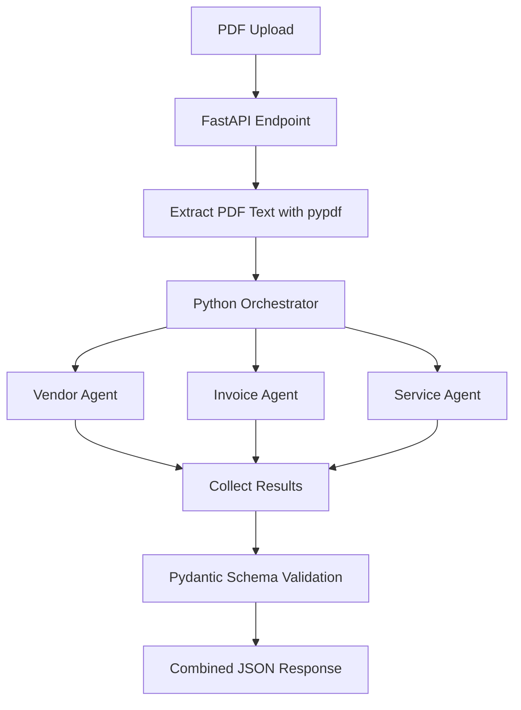

# Multi-Agent Invoice Intelligence System

A Python-based multi-agent application that extracts structured information from PDF invoices using **FastAPI**, **Ollama**, and **Pydantic**.

The application uses three specialized LLM agents:

1. **Vendor Agent** — extracts issuer, customer, vendor identifier, invoice number, and dates.
2. **Invoice Agent** — extracts invoice type, currency, charges, taxes, arrears, and amount payable.
3. **Service Agent** — extracts service details, billing period, usage information, and unit price.

A lightweight Python orchestrator runs the agents concurrently with `asyncio.gather()`, collects their results, and returns a combined JSON response.

> **Status:** Working proof of concept. It is designed for local experimentation and learning, not as a fully production-hardened accounts-payable system.

## Architecture



Each agent sends its instructions and the extracted document text to the local Ollama chat API. Ollama generates structured output using the schema supplied by the application. Pydantic validates the returned JSON.

## Technology Stack

- **Python** — application logic and asynchronous execution
- **FastAPI** — REST API and interactive API documentation
- **Ollama** — local LLM inference
- **Llama 3.2 (`llama3.2`)** — model used by default
- **Pydantic** — structured output validation
- **pypdf** — text extraction from text-based PDFs
- **httpx** — asynchronous HTTP requests to Ollama
- **asyncio** — concurrent execution of the three agents

## Prerequisites

Install the following before starting:

- Python 3.10 or newer (Python 3.11+ recommended)
- [Git](https://git-scm.com/downloads)
- [Ollama](https://ollama.com/download)

Check your Python and Git installations:

```bash
python --version
git --version
```

## 1. Fork and clone the repository

1. Open this repository on GitHub.
2. Select **Fork** to create your own copy.
3. Clone your fork. Replace the URL below with your fork's URL:

```bash
git clone https://github.com/<your-username>/<your-repository>.git
cd <your-repository>
```

Alternatively, clone the original repository if you only want to run the project.

## 2. Set up Ollama

Start Ollama using the method appropriate for your operating system. On macOS, open the Ollama application. On systems where Ollama runs as a service, start that service.

Download the model:

```bash
ollama pull llama3.2
```

Confirm that the model is available:

```bash
ollama list
```

The application expects the Ollama API at:

```text
http://localhost:11434
```

The default model and endpoint are configured at the top of `multi_agent_invoice.py`:

```python
OLLAMA_URL = "http://localhost:11434/api/chat"
MODEL_NAME = "llama3.2"
```

If you change the model, make sure it supports the structured-output format used by the application and test its extraction quality.

## 3. Create a virtual environment

### macOS / Linux

```bash
python3 -m venv .venv
source .venv/bin/activate
```

### Windows PowerShell

```powershell
py -m venv .venv
.\.venv\Scripts\Activate.ps1
```

## 4. Install Python dependencies

With the virtual environment activated:

```bash
python -m pip install --upgrade pip
pip install fastapi uvicorn httpx pypdf pydantic python-multipart
```

Optional: save the dependencies in a `requirements.txt` file so setup is repeatable:

```text
fastapi
uvicorn
httpx
pypdf
pydantic
python-multipart
```

Then install them with:

```bash
pip install -r requirements.txt
```

## 5. Run the application

From the directory containing `multi_agent_invoice.py`, run:

```bash
uvicorn multi_agent_invoice:app --reload
```

The API will be available at:

- API base: <http://127.0.0.1:8000>
- Interactive Swagger UI: <http://127.0.0.1:8000/docs>
- OpenAPI schema: <http://127.0.0.1:8000/openapi.json>

Keep Ollama running while using the application.

## 6. Process a PDF invoice

### Using Swagger UI

1. Open <http://127.0.0.1:8000/docs>.
2. Expand `POST /process-invoice`.
3. Select **Try it out**.
4. Choose a PDF file.
5. Select **Execute**.
6. Review the JSON response.

### Using curl

Replace `invoice.pdf` with the path to your own PDF:

```bash
curl -X POST \
  "http://127.0.0.1:8000/process-invoice" \
  -H "accept: application/json" \
  -H "Content-Type: multipart/form-data" \
  -F "file=@invoice.pdf;type=application/pdf"
```

The endpoint accepts PDFs up to 10 MB and 50 pages in this example.

## Example response

The actual values depend on the uploaded invoice and model output. A response has this general shape:

```json
{
  "status": "COMPLETED",
  "results": {
    "vendor": {
      "issuer_name": "Example Utility Limited",
      "customer_name": "Example Customer",
      "vendor_identifier": "123456",
      "invoice_number": "INV-1001",
      "bill_date": "2025-12-19",
      "due_date": "2026-01-09",
      "evidence": []
    },
    "invoice": {
      "invoice_type": "Estimated",
      "currency": "INR",
      "consumption_charges": 1200.0,
      "taxes": [],
      "arrears": 0.0,
      "amount_payable": 1416.0,
      "evidence": []
    },
    "service": {
      "service_name": "Utility supply",
      "service_identifier": null,
      "billing_period_start": null,
      "billing_period_end": null,
      "usage_type": "unknown",
      "usage_quantity": null,
      "usage_unit": null,
      "unit_price": null,
      "evidence": []
    }
  }
}
```

The values above are illustrative placeholders, not the output of a real invoice run. The model may return `null` for fields not present in the document.

If an agent fails, the orchestrator can return `PARTIAL_FAILURE` with the successful agent results and error details.

## How orchestration works

The orchestrator uses:

```python
results = await asyncio.gather(
    vendor_agent(client, document_text),
    invoice_agent(client, document_text),
    service_agent(client, document_text),
    return_exceptions=True,
)
```

The orchestrator is ordinary Python code; a dedicated agent orchestration framework is not required for this initial workflow.

## Current limitations

- **Text-based PDFs:** `pypdf` extracts embedded text. Scanned or image-only PDFs require an OCR stage, which is not included.
- **No persistent storage:** Files, job states, and results are not stored in a database.
- **Synchronous request lifecycle:** The upload request waits for processing to finish. Durable background jobs and a queue are not included.
- **Basic validation:** Pydantic checks the response schema, but the example does not independently verify all financial totals or source evidence.
- **LLM variability:** Extraction can be incorrect or incomplete. Review results before using them for financial decisions.
- **Privacy:** Document text is sent to the configured local Ollama service. Confirm your deployment and logging settings before processing sensitive information.
- **Security hardening:** Authentication, authorization, malware scanning, rate limiting, and comprehensive resource controls must be added before production deployment.

## Potential improvements

- Add OCR for scanned invoices.
- Add vendor-specific Markdown instruction files and configuration.
- Add independent financial and evidence validation.
- Store documents and results in PostgreSQL.
- Add background workers and a durable queue for batch processing.
- Add evaluation datasets and automated tests for each vendor.
- Add structured logging, monitoring, and human review for uncertain results.
- Add RAG when the system needs to compare invoices with contracts, policies, or historical documents.

## Contributing

Contributions and suggestions are welcome.

1. Fork the repository.
2. Create a feature branch:

   ```bash
   git checkout -b feature/your-feature
   ```

3. Make and test your changes.
4. Commit your work:

   ```bash
   git add .
   git commit -m "Add your feature"
   ```

5. Push your branch and open a pull request.

Please avoid committing private invoices, customer information, API credentials, or other sensitive data.

## License

Choose a license before publishing this repository for reuse. If you want others to use, modify, and redistribute the project, consider adding an appropriate open-source license file such as MIT. Do not claim a license until the repository includes it.

---

Built as a practical learning project to explore Python, local LLMs, structured extraction, asynchronous execution, and multi-agent orchestration.
